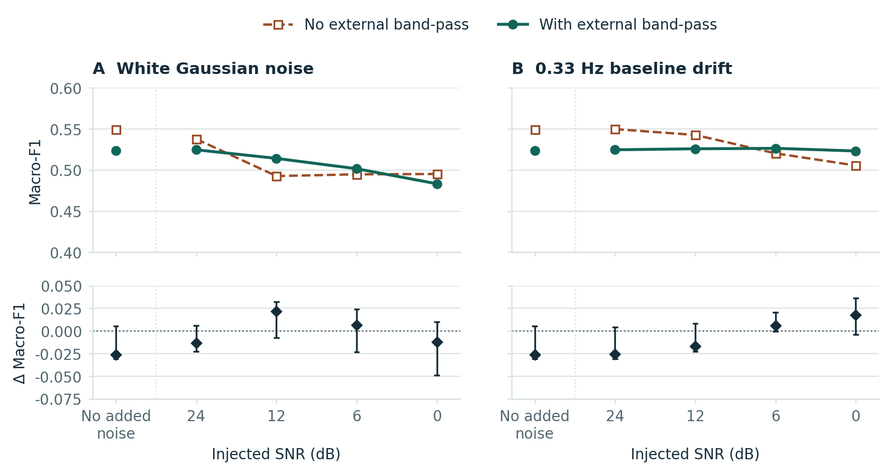

# How Much Does Filtering Help?

Does a 0.5–40 Hz band-pass improve ECG beat classification on held-out MIT-BIH subjects? The two branches are **No external band-pass** and **With external band-pass**. Both subtract a local baseline before measuring waveform shape. The noise experiment fixes beat locations at the annotations, and the main XQRS experiment uses the original recordings without added noise.

## Results

The test set contains 47,552 N/S/V/F beats from 21 subjects. The paired bootstrap resamples subjects with both fitted models and noise waveforms fixed.

| Experiment at reference positions | No external band-pass macro-F1 | With external band-pass macro-F1 | Difference |
| --- | ---: | ---: | ---: |
| No added noise | 0.5495 | 0.5237 | −0.0258 |
| White Gaussian noise, 0 dB | 0.4954 | 0.4835 | −0.0119 |
| 0.33 Hz baseline drift, 0 dB | 0.5057 | 0.5234 | +0.0177 |

The paired 95% intervals include zero in all nine conditions. On the original recordings, XQRS reached a detection F1 of 0.9978. With the external band-pass, macro-F1 went from 0.5237 at annotated positions to 0.5183 after counting XQRS misses and extra detections. In a separate XQRS run at 0 dB drift, both branches reached the same detection F1 while end-to-end macro-F1 went from 0.4986 to 0.5191. [Result tables](results/)



## Reproduce on CPU

Use Python 3.12 and uv on Linux or WSL. [Install uv](https://docs.astral.sh/uv/getting-started/installation/)

```bash
git clone --branch submission-v2 https://github.com/yumike743-art/bmsp-ecg
cd bmsp-ecg
uv sync --locked
uv run pytest -q
uv run python -m bmsp_ecg data fetch --config configs/experiment.yaml
uv run python -m bmsp_ecg smoke --config configs/experiment.yaml
uv run python -m bmsp_ecg run --config configs/experiment.yaml
uv run python -m bmsp_ecg stress --config configs/experiment.yaml
uv run python -m bmsp_ecg ablate --config configs/experiment.yaml
uv run python scripts/verify_results.py outputs/run
```

The fetch command downloads WFDB header, signal and annotation files, checks the official SHA-256 hashes and keeps existing files that pass. For a local copy, use `--data-dir /path/to/mitdb` with the data, smoke, run, stress and ablate commands. `data check` checks that all three files per record exist and verifies hashes when `SHA256SUMS.txt` is present.

The smoke run uses six recordings and 12 trees per branch. The full experiment uses 300 trees per branch and took 180.5 s with a peak process RSS of 812 MiB on Linux x86-64, CPython 3.12.14 and two CPU workers. This timing covers the experiment after the source-data checks. [Verification notes](docs/VERIFICATION.md)

The stress command reuses the fitted models, adds identical 0 dB drift to both branches and runs XQRS separately. It pairs the results by record and annotated sample to compare which beats are found and where the detector places them. To rebuild the record 213, minority-error and drift alignment tables from the saved predictions and detections, run the following command.

```bash
uv run python -m bmsp_ecg analyze --config configs/experiment.yaml
```

The ablation fits RR-only and waveform-only forests to the original filtered training beats with the same configuration and seed. It scores them at annotated test positions without added noise and uses the saved full-feature predictions for comparison.

Pass the same `--output-dir` to commands that share a run. If uv selects a different Python version, run `uv sync --locked --python 3.12`.

## Experiment design

- **Acquisition and split.** 360 Hz, MLII chosen by header name. Exclude paced records 102, 104, 107 and 217. The modified DS1/DS2 puts records 201 and 202 in the same training subject group. The fixed manifest is [configs/split.csv](configs/split.csv).
- **Models.** Window [−0.25, +0.35) s, RR context and fixed-time morphology features, training-only median imputation and class-weighted random forests. The filtered arm applies a full-record forward–backward 0.5–40 Hz Butterworth filter. The configuration is [configs/experiment.yaml](configs/experiment.yaml).
- **Noise.** White Gaussian noise and 0.33 Hz drift are injected at 24, 12, 6 and 0 dB relative to the demeaned recorded signal. Both arms see the same waveform realization per record and condition.
- **Evaluation.** Treat N/S/V/F equally in macro-F1. Evaluate noise at reference positions and score the primary XQRS experiment without added noise. The 0 dB baseline drift replay scores QRS F1, end-to-end macro-F1 and S/V recall in both branches. XQRS uses its internal processing in each branch. Zero-phase filtering and following RR intervals use future samples.

The detector call uses `xqrs_detect(sig=filtered, fs=360, conf=None, learn=True, verbose=False)`. WFDB 4.3.1 defaults to an initial heart rate of 75 beats/min, a 25–200 beats/min range, 0.10 s expected QRS width, 0.20 s refractory period, thresholds of 0.13 initially and 0 at minimum, and a 0 s T-wave inspection period. The evaluation match tolerance is 150 ms.

## Output files

| Path under the run directory | Contents |
| --- | --- |
| `data_audit.csv`, `beat_counts.csv`, `training_beats.csv.gz` | File checksums, lead columns, symbol/beat counts and training index |
| `reference_predictions.csv.gz`, `detection_events.csv.gz` | Per-beat classification and detection ledgers |
| `summary.csv`, `per_class.csv`, `confusion.csv` | Protocol, class and confusion statistics |
| `noise_metrics.csv`, `snr_audit.csv`, `paired_detection.csv` | Robustness and detection contrasts, calibration and bootstrap intervals |
| `sensitivity_record_213.csv`, `minority_errors.csv` | Post hoc sensitivity and classification/detection error counts |
| `stress/events.csv.gz`, `stress/metrics.csv`, `stress/paired_delta.csv` | Drift replay QRS and classification results |
| `stress/noise_audit.csv`, `stress/provenance.json` | Shared waveform hashes, SNR and source run/model hashes |
| `stress/alignment.csv` | Paired QRS match status, changes to detected sample positions and class prediction changes at identical positions |
| `ablation/metrics.csv`, `ablation/predictions.csv.gz`, `ablation/provenance.json` | Feature ablation scores, prediction ledger and source hashes |
| `detection_by_record.csv`, `detection_window_skips.csv` | Per-record QRS metrics and clipped edge counts |
| `qc_*`, `failure_*`, `figures/` | ECG figure source data and generated vector/PNG graphics |
| `run_metadata.json`, `*_model.joblib` | Timing, memory, environment and fitted pipelines |

Smoke writes to `outputs/smoke/`, the full run to `outputs/run/`, the stress replay to `outputs/run/stress/`, and ablation to `outputs/run/ablation/`. Both PDF commands write to `submission/`. Load Joblib models only from a trusted run.

## Generate preview PDFs

```bash
uv run python -m bmsp_ecg report --config configs/experiment.yaml --draft
```

## Generate submission PDFs

Save the cover fields in a local `identity.yaml`. Use the optional `name_native` field for a second spelling.

```yaml
name: "Your name as it should appear on the cover"
name_native: "Optional second spelling"
student_id: "Your student ID"
date: "YYYY-MM-DD"
repository: "https://github.com/yumike743-art/bmsp-ecg"
```

```bash
uv run python -m bmsp_ecg report --config configs/experiment.yaml --identity identity.yaml
```

The renderer writes `BMSP_Report.pdf` for **1. report** and `BMSP_Code_Documentation.pdf` for **2. Code**. The submission directory and local identity file are ignored by Git. Both documents record the source tag and short commit from a clean tagged checkout. The project ZIP stores the same version in `SOURCE_VERSION.json`.

## Sources

See [docs/SOURCES.md](docs/SOURCES.md) for the dataset, published methods and software references.
